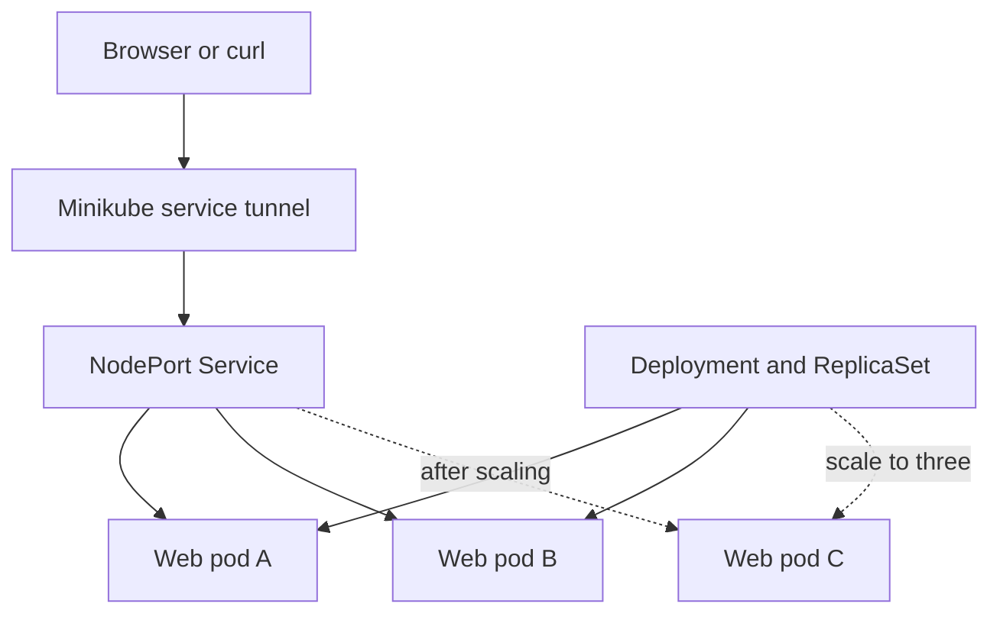

# Week 04: Containerization, Image Optimization, and Orchestration

**Author:** Bashir Abdulkadir  
**Application:** Container Lab, a dependency-free Node.js web service  
**Deployment choice:** Option B, Kubernetes on local Minikube

## Current verification status

The native Node endpoint tests have been executed by the assistant. Docker and Kubernetes are unavailable in that workspace, so **container build, image size, deployed process UID, scaling, pod replacement, rolling update, and rollback remain pending**. Do not submit those checks as passed until you run them. See [QA_CHECKLIST.md](docs/QA_CHECKLIST.md). No GitHub repository or video has been published from this workspace.

## Architecture



Each stateless pod serves `/`, `/healthz`, `/readyz`, and `/api/runtime`. The page shows pod identity, version, uptime, and process UID. There is no database or persistent user data. Kubernetes distributes new connections among ready endpoints; browser connection reuse may repeatedly reach the same pod.

The Dockerfile uses two stages based on the fixed lightweight `node:22.16.0-alpine3.22` tag. The build stage installs from package metadata before copying application files, runs tests, and creates a runtime-only directory. The final stage runs as the base image's `node` user, UID 1000. Tests and build scripts stay outside the final image. Fixed version tags should be refreshed and scanned before real production use. No image size or vulnerability result is assumed.

The Deployment starts with 2 replicas and uses RollingUpdate with `maxUnavailable: 0` and `maxSurge: 1`. Each pod requests 100m CPU / 64Mi memory and has limits of 500m CPU / 128Mi memory. Startup, liveness, and readiness probes serve different purposes. The runtime uses a read-only root filesystem, dropped capabilities, restricted privilege escalation, and no service-account token.

## Prerequisites on Windows

- Docker Desktop, **running** with the Linux container engine. `docker info` must show a working Server section.
- Minikube and kubectl on PATH. See official [Minikube setup](https://minikube.sigs.k8s.io/docs/start/).
- Enough Docker Desktop resources for a 2-CPU, 3-GB Minikube profile plus the host and image build.
- PowerShell. Node.js 22+ is optional for host tests; Docker builds run tests automatically.
- Network access to pull base and Minikube images.

Run these in **PowerShell**, not Command Prompt:

```powershell
docker info
minikube version
kubectl version --client
```

If Docker reports no server, fix Docker Desktop before proceeding. If it reports a WSL or virtualization problem, resolve that prerequisite first. A client version alone does not prove Docker is running.

## Start here: build and deploy

Extract this project folder, open it in VS Code, then open a PowerShell terminal **inside the folder containing Dockerfile and package.json**. Check:

```powershell
Get-ChildItem Dockerfile, package.json, k8s/app.yaml
```

Run the provided deployment script:

```powershell
powershell -NoProfile -ExecutionPolicy Bypass -File .\scripts\deploy.ps1
```

That process performs these exact commands. You can run them manually instead:

```powershell
minikube start -p week04 --driver=docker --cpus=2 --memory=3072
docker build --progress=plain -t week04-web:1.0.0 .
minikube -p week04 image load week04-web:1.0.0
kubectl --context=week04 apply -f k8s/app.yaml
kubectl --context=week04 -n week04 rollout status deployment/web-app --timeout=180s
kubectl --context=week04 -n week04 get pods -o wide
```

The explicit context prevents accidentally targeting another cluster. All image loads target the same Minikube profile. `imagePullPolicy: Never` is for this local image workflow only.

## Open the application

In a **second PowerShell window**, run and leave this running:

```powershell
minikube -p week04 service web-app -n week04 --url
```

Use the URL it prints, which may contain a randomly allocated local port. Do not assume `localhost:30080` works with the Windows Docker driver. In the first window, set the actual URL:

```powershell
$BaseUrl = Read-Host 'Paste the service URL printed by Minikube'
Start-Process $BaseUrl
curl.exe -i "$BaseUrl/healthz"
curl.exe "$BaseUrl/api/runtime"
```

Alternative for diagnosing connectivity: `kubectl --context=week04 -n week04 port-forward service/web-app 8080:80`. That reaches one chosen pod and may disconnect when that pod disappears. Use the Minikube service tunnel for the scaling/replacement demo and recreate the port-forward if using that fallback.

## Run QA and collect evidence

Start with the fresh v1 deployment above. The QA script scales to 3, deletes one pod, verifies a new UID, updates to v2, then rolls back to v1. It is a demonstration sequence, not a general production test runner. Repeating it after unrelated deployments may invalidate its v1 rollback assumption.

```powershell
powershell -NoProfile -ExecutionPolicy Bypass -File .\scripts\qa.ps1 -BaseUrl $BaseUrl
```

Read `evidence/qa-results.json` and `evidence/cluster-transcript.txt`. Failed commands stop the script and record a failure. Review the evidence before updating the checklist. The script checks endpoint availability at individual moments; it does **not** measure uninterrupted availability or inspect DevTools.

### Commands to demonstrate manually in the video

Build and inspect the image:

```powershell
docker images week04-web
docker image inspect week04-web:1.0.0 --format '{{.Size}}'
docker image inspect week04-web:1.0.0 --format '{{.Config.User}}'
$WebPod = kubectl --context=week04 -n week04 get pods -l app=web-app -o jsonpath='{.items[0].metadata.name}'
kubectl --context=week04 -n week04 exec $WebPod -- id -u
kubectl --context=week04 -n week04 exec $WebPod -- ps -o user,pid,args
```

UID 1000 and a node-owned Node process are expected. A Docker build warning or runtime error should be investigated rather than described as a clean build.

Scale and recover:

```powershell
kubectl --context=week04 -n week04 scale deployment/web-app --replicas=3
kubectl --context=week04 -n week04 rollout status deployment/web-app --timeout=180s
kubectl --context=week04 -n week04 get pods -o wide
$VictimPod = kubectl --context=week04 -n week04 get pods -l app=web-app -o jsonpath='{.items[0].metadata.name}'
kubectl --context=week04 -n week04 get pod $VictimPod -o jsonpath='{.metadata.uid}'
kubectl --context=week04 -n week04 delete pod $VictimPod
kubectl --context=week04 -n week04 get pods -w
```

Wait for 3 pods to be Ready and press **Ctrl+C** to stop watching. Show the new pod name/UID and repeat `/healthz`. The Deployment remains running while the ReplicaSet replaces its deleted pod. Do not delete the Deployment.

Rolling update and rollback:

```powershell
kubectl --context=week04 -n week04 set env deployment/web-app APP_VERSION=v2
kubectl --context=week04 -n week04 rollout status deployment/web-app --timeout=180s
curl.exe "$BaseUrl/api/runtime"
kubectl --context=week04 -n week04 rollout history deployment/web-app
kubectl --context=week04 -n week04 rollout undo deployment/web-app
kubectl --context=week04 -n week04 rollout status deployment/web-app --timeout=180s
curl.exe "$BaseUrl/api/runtime"
```

This changes the pod template's application version variable and proves a configuration rollout; it does not claim a new code image was built. Recheck v2, then v1. Do not edit the manifest and reapply it during this sequence: it declares the original two replicas and v1.

### Browser checks

Open DevTools with F12. In Network, reload the page and show successful responses for `/`, `/healthz`, and `/api/runtime`. Click one request to show HTTP status, response headers, and timing. In Console, confirm there are no uncaught frontend errors. Click **Refresh runtime**. Save screenshots to `evidence/` and mark those checklist rows only after observing the result.

## Optional host tests

```powershell
npm ci --ignore-scripts --no-audit --no-fund
npm test
npm run build
node dist/src/server.js
```

Visit `http://localhost:8080`. Host execution can show your host UID or no UID on Windows; it is not proof of the container user. Ctrl+C stops the host server. Kubernetes settings come from `k8s/app.yaml`; local `.env.example` is illustrative and is not automatically loaded by this server.

## Troubleshooting

- `ErrImageNeverPull`: run the matching profile's image-load command and restart the deployment.
- `Pending`: inspect `kubectl --context=week04 -n week04 describe pods`. Check cluster CPU/memory and image availability.
- `CrashLoopBackOff`: inspect `kubectl --context=week04 -n week04 logs deployment/web-app` and pod events.
- Service URL fails: keep the Minikube service terminal open and use its printed URL. Check all pods are ready.
- Rollback returned something other than v1: inspect rollout history and reset the demo to a known v1 deployment before repeating it.

## Tear down

```powershell
kubectl --context=week04 delete namespace week04
minikube stop -p week04
```

Optional removal of this dedicated lab cluster: `minikube delete -p week04`. This removes this profile and its local cluster contents.


